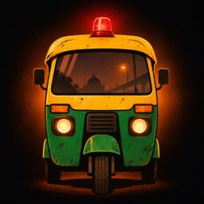
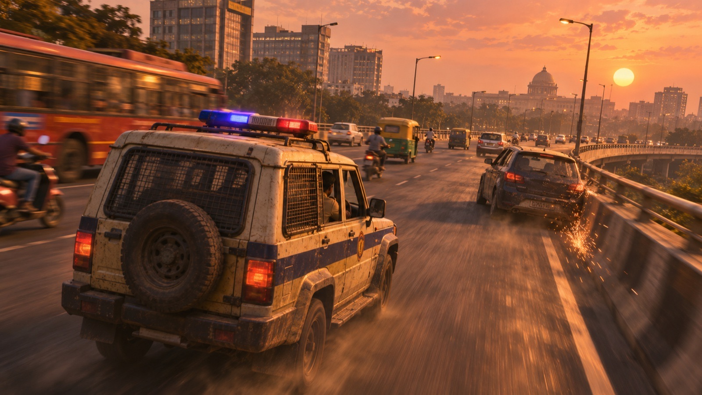
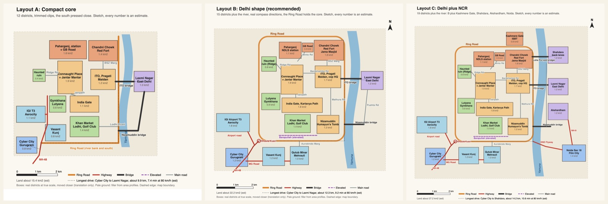
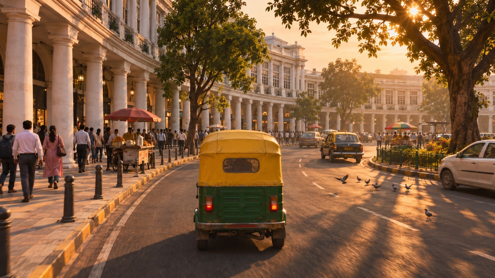
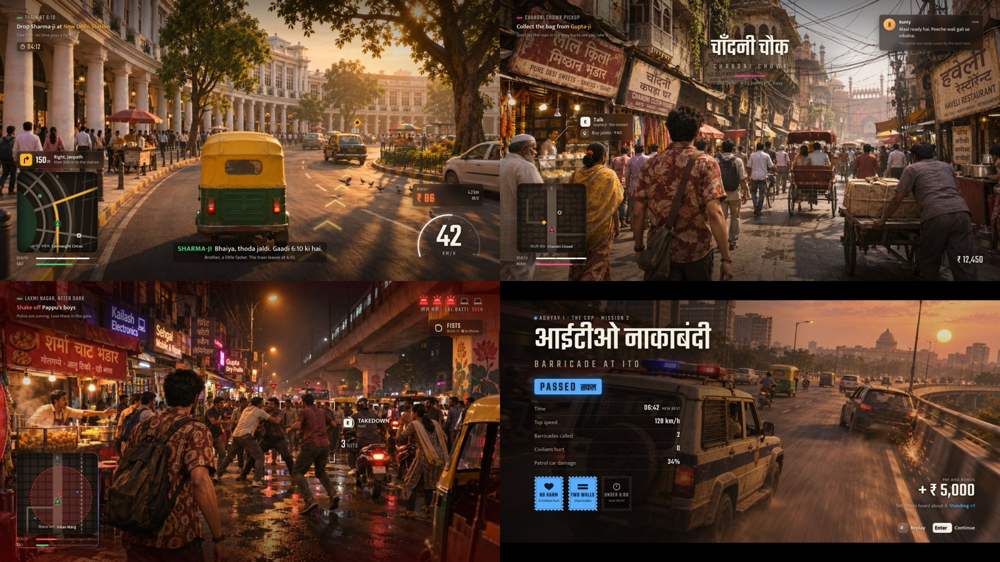

<div align="center">



# KALESH

### Three lives. One Dilli. Full drama.

*An open-world action game set in a compressed, real Delhi.*




<sub>Concept art for mood. Not in-game footage (yet).</sub>

</div>

---

## What is Kalesh?

*Kalesh* (कलेश): Hindi for a loud, messy fight that pulls everyone in.

You live three lives in one Delhi. An **auto driver** who knows every gali. A **cop** who is honest enough to be in the way. A **small-time fixer** who can get anything for a price. Each has their own money, their own trouble and their own day. Then their stories cross, and collide, in loud filmi set pieces across real places: Connaught Place, India Gate, ITO, Chandni Chowk, Red Fort.

It plays like a Hindi action film shot in a real, honest city. Chases over flyovers. Fistfights in bazaar lanes. A wanted level that sends the police after you. And quiet city life in between.

## The three lives

| | 🛺 The Driver | 🚓 The Cop | 💼 The Fixer |
|---|---|---|---|
| **Who** | Rents an auto, works the stands at CP, the railway station and the Metro exits | A sub-inspector near ITO, patrolling the central core | Arranges anything in Old Delhi's back lanes: documents, deliveries, debts |
| **Home turf** | Laxmi Nagar, East Delhi | ITO and Connaught Place | Chandni Chowk and Paharganj |
| **Rides** | Auto, about 65 km/h of pure nerve | Patrol car, police bike | Scooter, plus any car he takes |
| **Signature** | Knows every gali: shortcuts, gap weaving, near misses | Calls a barricade at the next junction, PIT takedowns, arrests | Tailing, getaways, talking his way in |
| **On foot** | Brawler with whatever is lying around | Lathi, pistol, arrest takedown | Street fighter, pistol, knife |
| **Wants** | Pay off the auto, keep the family out of it | Promotion, or integrity | Get out from under a bigger boss |

## Pillars

1. **Three lives, one city.** Every mission moves one life forward and touches another. What one character does can show up in another's day.
2. **Filmi, never cheap.** Action as loud as a Hindi blockbuster. Every fight has a reason and a cost. Never cruel, never a joke at someone's expense.
3. **The city opens up.** Real Delhi is the reward. New districts open through the story, never through an invisible wall. The first sight of a landmark is a moment.

And one standing rule over all of them: **show Delhi honestly, with respect.** No real people, parties, brands or police units. Poverty, crime and policing are shown as they are, never as spectacle.

## The map

A **compressed real Delhi**. Real districts at true scale, built from open map data, pulled closer together and joined by the ring roads, the river and the bridges. Smaller than GTA V, big enough never to feel empty.



| Stage | Districts |
|---|---|
| **Pilot** (Act 1) | Connaught Place and Jantar Mantar, India Gate, ITO, Chandni Chowk and Red Fort (about 7 km²) |
| **First release** | Adds Gurugram, Laxmi Nagar, Kashmere Gate and ISBT, Humayun's Tomb and Nizamuddin, and more |
| **Later** | Noida, Shahdara, Akshardham |

## The first playable slice

Act 1 in miniature, in the pilot districts:

| | Mission | Lead | What you do |
|---|---|---|---|
| M01 | **Train at 6:10** | Driver | Race a fare to the station against the clock, take the gali shortcut, find the bag left behind |
| M02 | **Barricade at ITO** | Cop | Pursuit over the ITO flyovers, call the barricade, foot chase and takedown |
| M03 | **Chandni Chowk pickup** | Fixer | Push through the bazaar crowd, a fistfight, a scooter getaway with the police on you |
| M04 | **Red Fort rush** | All three | Switch between all three lives in one finale: a gunfight and a chase |

## Look and feel

Fidelity aims at modern open-world games. The mood is golden-hour Delhi: dust in the air, sodium lights, crowded and alive.

<p>
  
  
</p>

<sub>Left: a mood target. Right: early HUD mockups. The final style is being chosen now.</sub>

## Where it stands

Kalesh is in **Phase 0**: deciding the style, the architecture and the game design before the real building starts.

- [x] Game design signed off
- [x] Godot baseline scene with measured performance
- [x] HUD research and mockups
- [ ] Style signed off (Godot style tests side by side)
- [ ] Architecture signed off (measured options table)
- [ ] Pilot districts, then the first playable slice

The `progress/` folder is the photo album. It gets a new shot each time the game visibly moves forward.

## Built with

- **[Godot 4.7](https://godotengine.org/)** for the game, desktop first (Mac and Windows)
- **OpenStreetMap** and open elevation data, baked offline into game tiles, with a map repair layer that fixes roads, junctions and lanes before they reach the game
- **Node and TypeScript** for the bake tools and the test harness
- **Playwright and screenshot checks** so every change is proven by a run and a picture, not a promise

## Run it

You need Node 20+ and Godot 4.7.2.

```bash
npm install
npm run play          # open the latest verified build
npm test              # unit and Godot tests
node harness/bin/dashboard.mjs   # live progress dashboard on http://localhost:4488
```

## Repo map

| Path | What lives there |
|---|---|
| `game/` | The Godot project |
| `tools/` | Map bake and geo tools |
| `harness/design/` | Game design, story, style and tech docs |
| `harness/verify/` | Test scenarios and mission play scripts |
| `progress/` | Shots of the game as it grows |
| `docs/` | Architecture and the debug hook contract |

---

<div align="center">

**Kalesh** is made by **Anmol**.

<sub>All characters, gangs, parties and police units in Kalesh are invented. Places are real; people are not.</sub>

</div>
