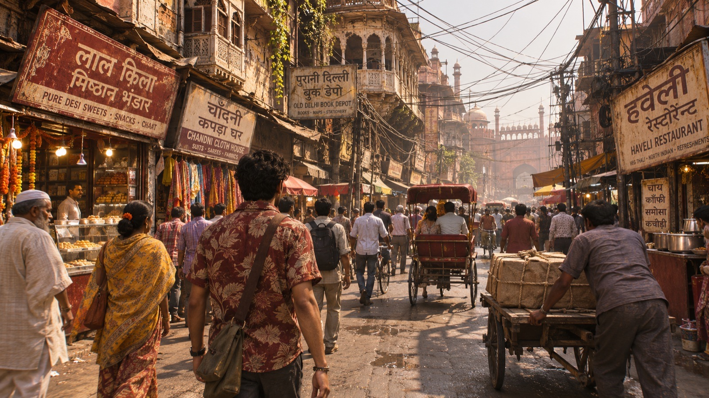

<p align="center">
  
</p>

<h1 align="center">KALESH</h1>

<p align="center"><b>Three lives. One Dilli.</b></p>

<p align="center">
  
</p>

An auto driver who knows every gali.
A cop who is honest enough to be in the way.
A fixer who can get you anything, for a price.

Kalesh is an open-world action game set in a real Delhi. Three people with their own money, their own trouble and their own day, until their stories run into each other. Chases over the ITO flyovers. Fistfights in Chandni Chowk. A wanted level that brings the whole force down on you. And the city humming in between.

<p align="center">
  
  
</p>

### The city

Real districts at true scale, built from open map data and pulled close together. Connaught Place, India Gate, Red Fort, Chandni Chowk, ITO first. Then the east bank, the south, Gurugram. The city opens up as the story does, never with an invisible wall.

### The rules

Filmi, never cheap. Every fight has a reason and a cost.
Real places, invented people. No real politicians, parties, brands or police units.
Delhi as it is. Rich and poor, built with the same care.

### Status

Early. The game design is locked. Look and engine architecture are being decided now, in Godot 4. Follow along in [`progress/`](progress/).

### Run

```bash
npm install
npm run play
```

Needs Node 20+ and Godot 4.7.

<br>

<p align="center"><sub>Made by Anmol.</sub></p>
