<p align="center">
  
</p>

<h1 align="center">KALESH</h1>

<p align="center"><b>Three lives. One Dilli.</b><br>
An open-world action game set in a real, data-built Delhi. Godot 4.7, Jolt physics, a custom map pipeline.</p>

<p align="center">
  
  <br><sub>Concept art (mood target). Everything below this point is from the running game or its build tools.</sub>
</p>

An auto driver who knows every gali. A cop who is honest enough to be in the way. A fixer who can get you anything, for a price. Three people with their own money, their own trouble and their own day, until their stories run into each other: chases over the ITO flyovers, fights in Chandni Chowk, a wanted level that brings the whole force down on you, and the city humming in between.

> **Status: pre-alpha, in active development.** The foundation is in: the real city centre streams from baked tiles, you can drive and walk it, and the light follows the clock. Buildings are still plain shells and the characters are stand-ins. Screenshots are labelled for what they are.

---

## Contents

- [What it looks like today](#what-it-looks-like-today)
- [The approach](#the-approach)
- [Building Delhi from open data](#building-delhi-from-open-data)
- [Driving and walking](#driving-and-walking)
- [Look and lighting](#look-and-lighting)
- [Design rules](#design-rules)
- [How it is built and verified](#how-it-is-built-and-verified)
- [Architecture](#architecture)
- [Roadmap](#roadmap)
- [Run it](#run-it)

---

## What it looks like today

<p align="center">
  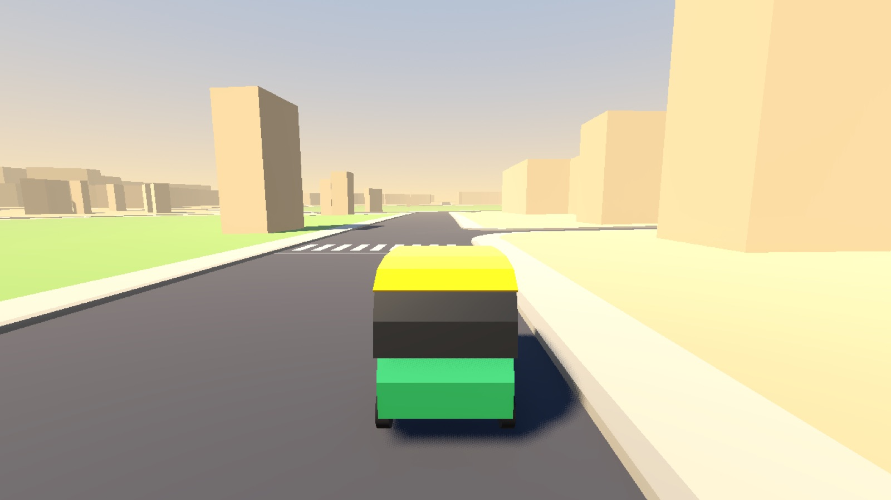
  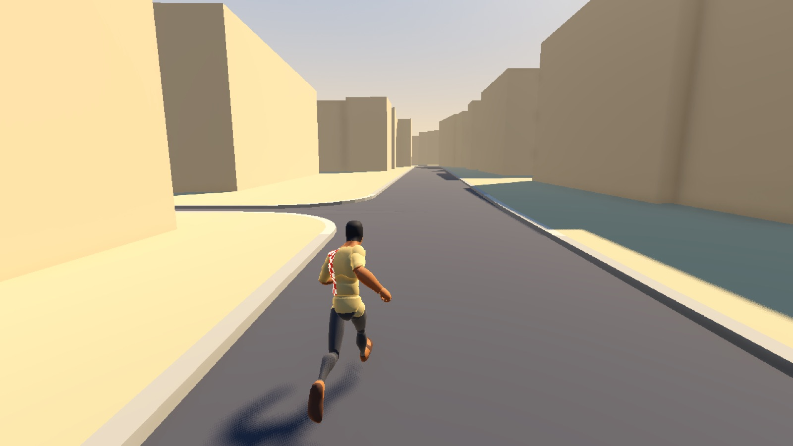
  <br><sub>Left: driving an auto down Janpath toward Connaught Place on the real road network. Right: on foot in a Chandni Chowk gali. Buildings are placeholder shells until the area generator lands.</sub>
</p>

<p align="center">
  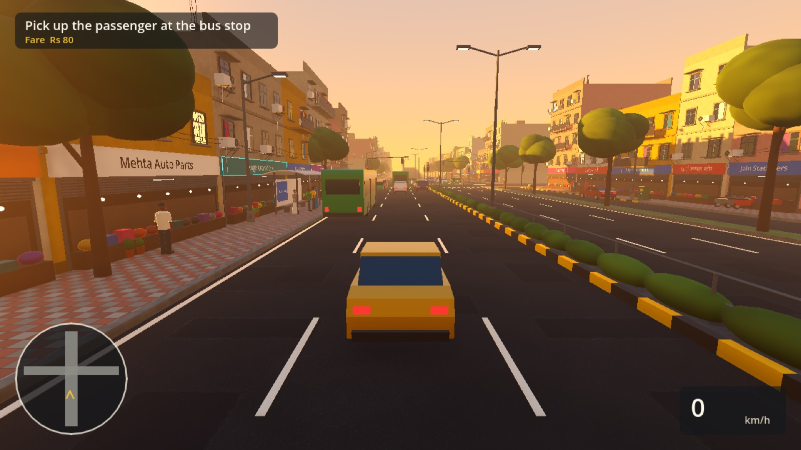
  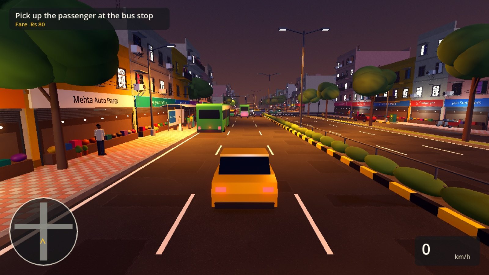
  <br><sub>The signed look on the street test scene. The light follows the day clock live: golden hour into night, lamps and windows switching on, with no reload.</sub>
</p>

## The approach

1. **A real city, not a lookalike.** The centre of Delhi (Connaught Place, India Gate, ITO, Chandni Chowk, Red Fort, Paharganj and the streets between) is built at true scale from open data, then repaired and reshaped until it plays well. The far areas (Qutub, Vasant Kunj, the airport, Gurugram) come later as compressed blocks on their real bearings.
2. **OSM is the first reference, not the final word.** Open map data gives the street layout. Real photos and satellite imagery decide widths, dividers, side roads and building shapes. The pipeline can remove, add and reshape anything, and every change carries its reason.
3. **Everything is a system.** One building generator plus per-area profiles makes thousands of buildings in each area's own style. One lane model makes every junction. That is how one small team gets a city.
4. **Evidence or it did not happen.** Every task has written acceptance criteria that are proven by tests, numbers or screenshots someone actually looked at.

## Building Delhi from open data

The map is baked offline by a TypeScript pipeline (`tools/bake/`) into 250 m binary tiles that the game streams. The pilot is 391 tiles, about 24 km² of the centre.

```
OSM + Overture footprints + Copernicus DEM
   -> block graph and classification
   -> repair rules and auto-repair (97.8% of issues settled on their own)
   -> lane-level road model (lane sets, tapers, gores, split zones)
   -> elevation solver (flyovers, ramps, clearances)
   -> road and junction mesh (watertight, no overlaps)
   -> terrain that fits the roads
   -> landmarks, areas, tiles  ->  Godot streams them
```

**Lane-level roads and real heights.** Every road is a set of lanes with tapers, gores and merge zones, and flyovers get real heights with clearance checks.

<p align="center">
  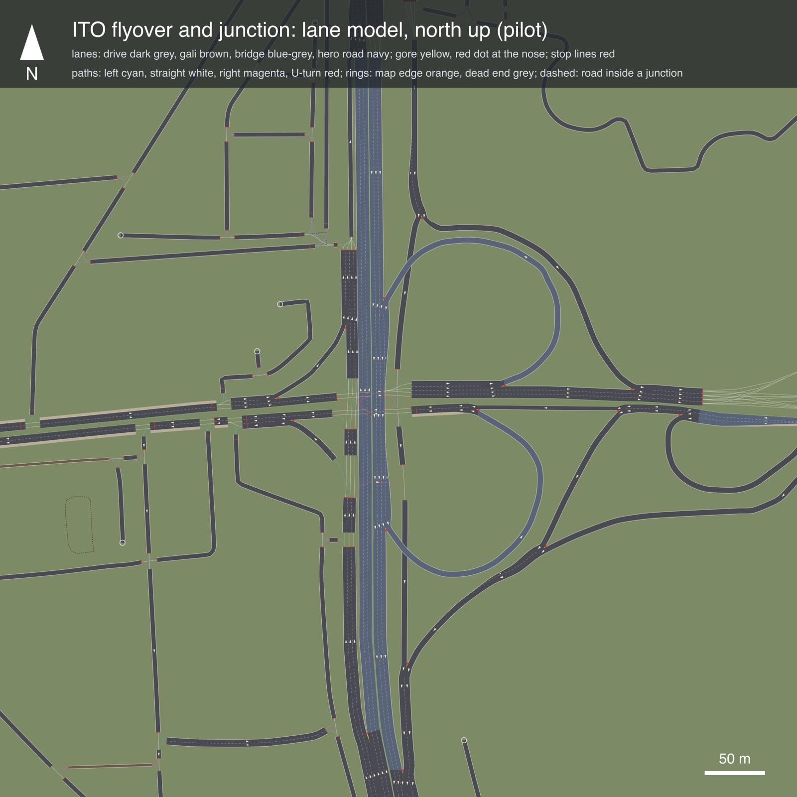
  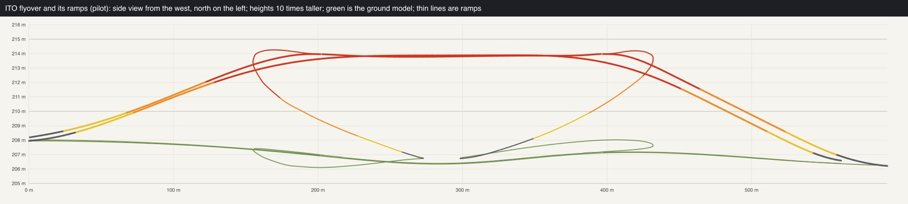
  <br><sub>The ITO flyover and junction in the lane model (left) and its solved heights and ramps from the side (right).</sub>
</p>

**Repairing broken map data automatically.** Open data has roads drawn twice, buildings standing on roads, dead ends and missing links. The repair layer fixes them by rule, and a top-view judge pass settles the rest against satellite imagery. The human review queue went from 2,868 issues to 0.

<p align="center">
  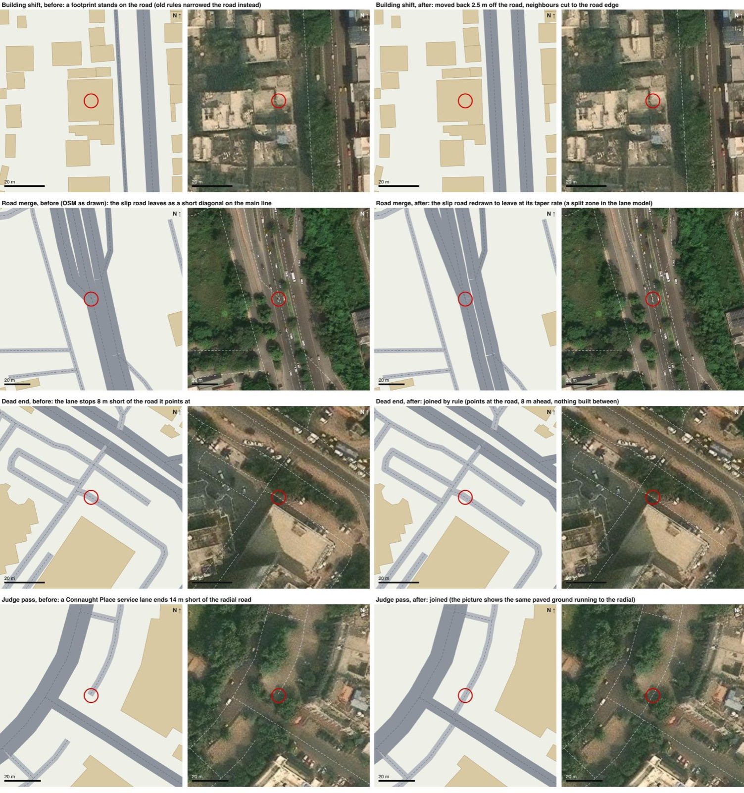
  <br><sub>Before and after, each beside the satellite view: a building moved back off the road, a slip road redrawn to merge at its taper, a dead end joined, and a service lane connected by the top-view judge pass.</sub>
</p>

**Junction clusters split into real junctions.** Kashmere Gate's tangle of overlapping road polygons, rebuilt as proper strips with piers under the flyover.

<p align="center">
  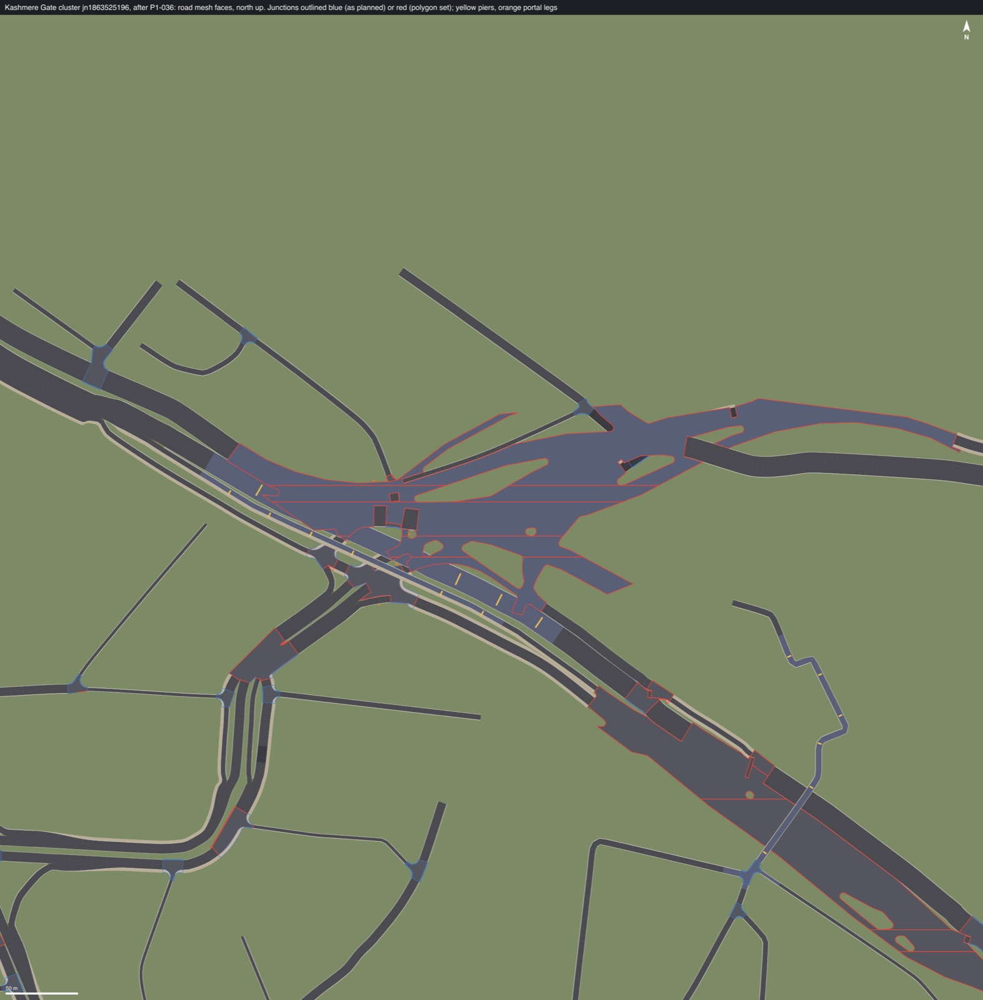
  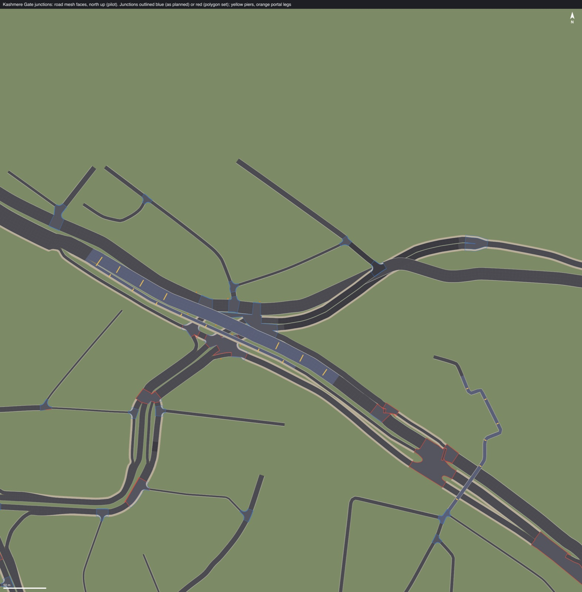
</p>

**Road width continuity.** A road keeps one cross-section along its corridor, and lane changes go through proper tapers. A bake gate fails on any sudden step (505 found, 0 left).

<p align="center">
  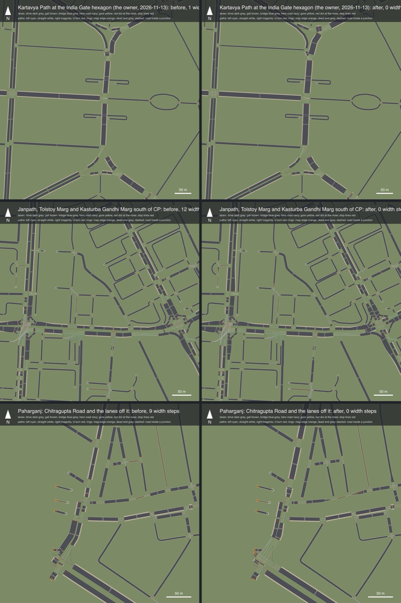
</p>

**Adding what the data is missing.** Map patches can add side roads, dividers, crossings and barriers, each citing a dated photo or satellite reference.

<p align="center">
  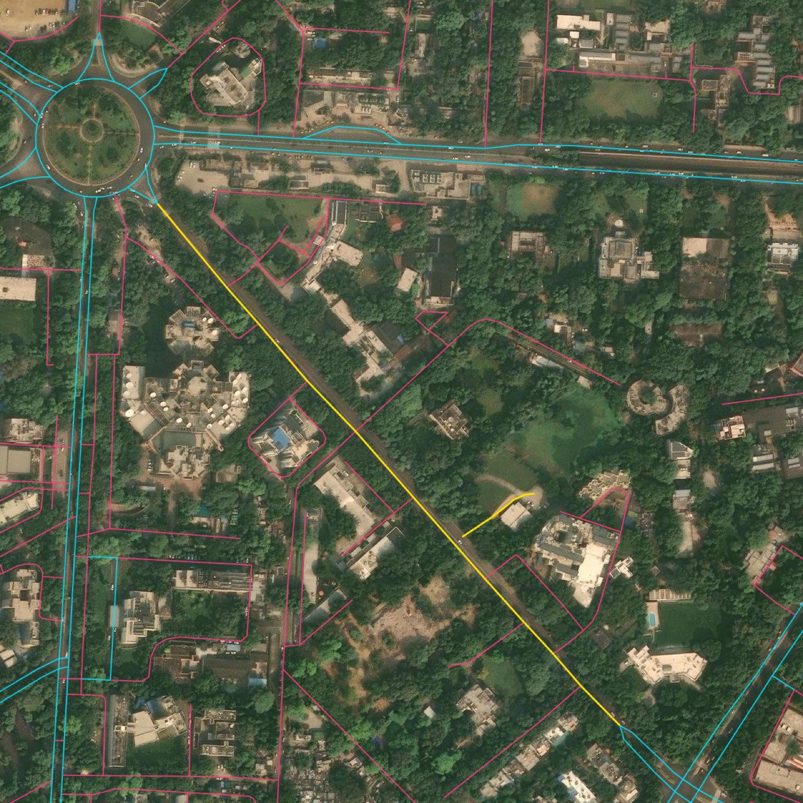
  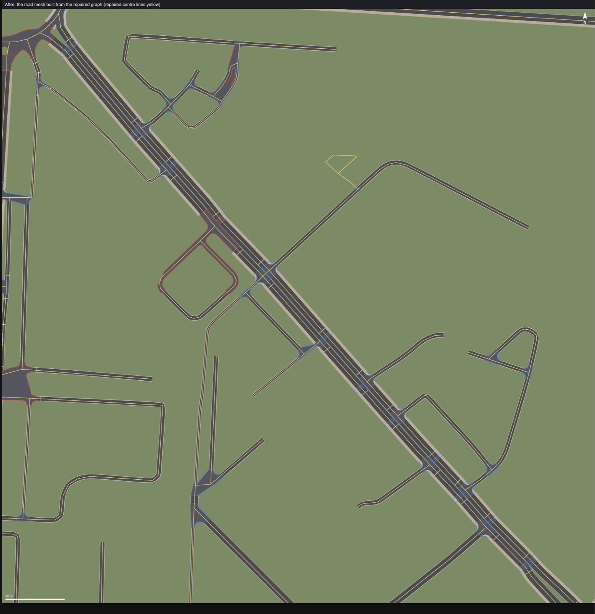
</p>

**Landmarks from a registry.** 332 landmarks joined by id across OSM and Wikidata and tiered hero, signature or marker, with hand-checked positions and heights. Far landmarks sit on the skyline at their real bearings.

<p align="center">
  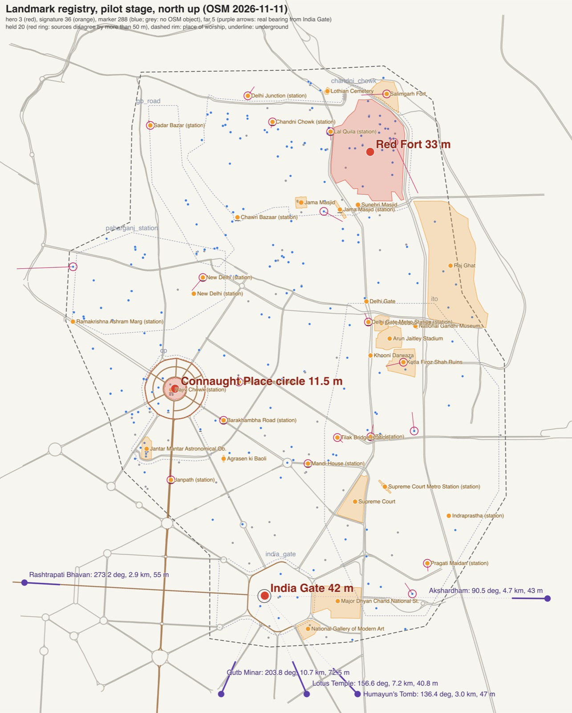
</p>

A browser **map inspector** (`tools/inspector/`) shows every issue in plain words, lets you draw fixes, and writes the same patch format the bake reads.

## Driving and walking

| | Measured |
|---|---|
| Car (raycast vehicle on Jolt) | 0 to 100 km/h 11.1 s, top 140 km/h, 100 to 0 in 41.5 m, full wheel contact over flyover deck joints at 100 km/h |
| Auto rickshaw | top 65 km/h, 4 m turning circle at 15 km/h, takes a 3 m gali corner without touching a wall |
| Scooter | top 90 km/h, hidden stabiliser with a visual lean |
| On foot | walk, jog, sprint with stamina, crouch, jump, vault up to 1.2 m, step-up on kerbs and stairs; get in and out of vehicles |
| Determinism | the same input script ends within 0.001 m at time scale 0.25, 1 and 4 |
| Cost | 0.02 ms per vehicle, 0.03 ms per animated character |
| Streaming | the pilot streams at 200 km/h with no frame over budget |
| Precision | no jitter or shimmer out to 10 km from the origin |

<p align="center">
  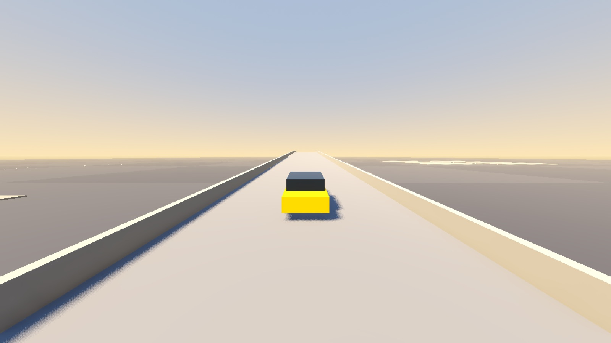
  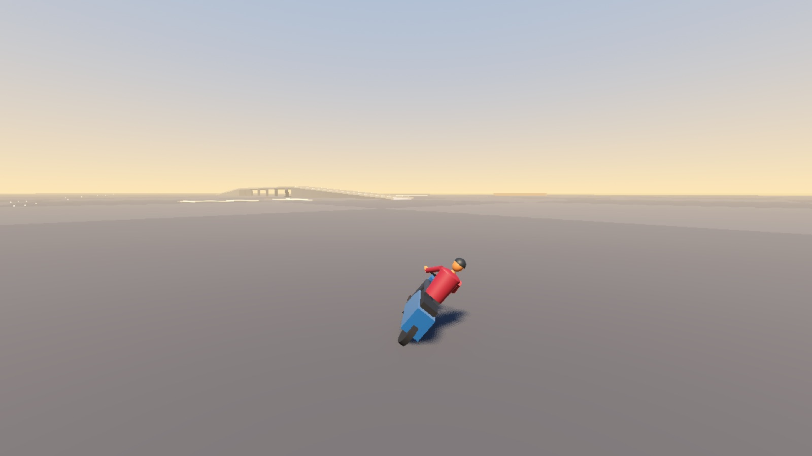
  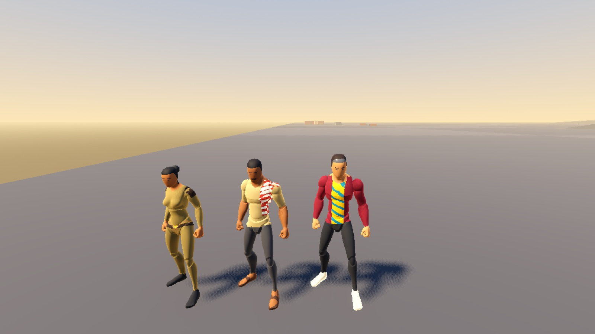
  <br><sub>The car at speed, the scooter leaning into a turn, and the three leads (stand-in bodies on a CC0 animation library until their models arrive).</sub>
</p>

## Look and lighting

The signed style is **stylised realism**: real proportions and shop-house massing, simplified surfaces, rich warm colour and sunlit haze, with grime that follows each area's real conditions (heavy in the Old Delhi bazaar, near zero in Lutyens). It was chosen from side-by-side tests in the engine with measured frame times, against Watch Dogs 2 for fidelity and a set of mood images.

<p align="center">
  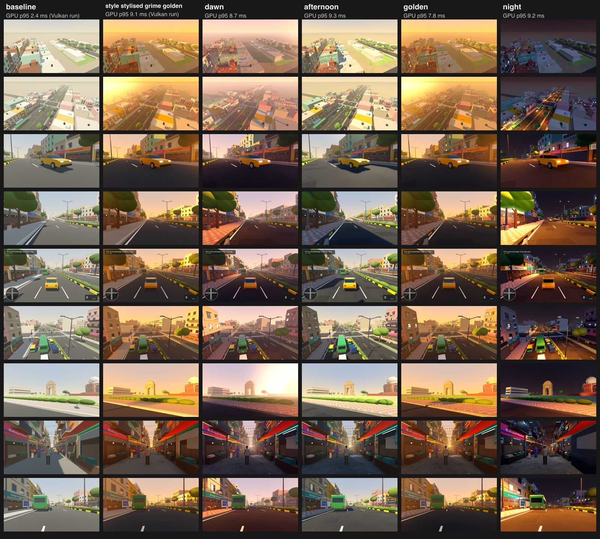
  <br><sub>The signed style on the look-test scenes across baseline, dawn, afternoon, golden and night, with GPU frame times per light.</sub>
</p>

- Four lights on one day curve, Filmic tonemap, a per-light 3D LUT, SSAO and SSIL.
- Budget: 60 fps on an M2 Pro MacBook Pro at 1080p. Today the streamed city runs at a 4 ms p95 frame time and under 400 draw calls.
- Cinematography is a first-class system: a shot grammar, lenses chosen per shot, weighted camera moves and per-scene light rigs for every cutscene.

## Design rules

- **Filmi, never cheap.** Big action, and every fight has a reason and a cost.
- **Real places, invented people.** No real politicians, parties, brands or police units. Every sign name is invented and checked by a test against a block list of real brands and parties.
- **Respect.** Delhi as it is, rich and poor built with the same care. No caricature, no community or religion as a punchline. Places of worship appear only where the sources place them and are never combat arenas.
- **One coordinate system.** East is +X, north is -Z, 1 unit is 1 metre. No mirroring anywhere, enforced by tests on the live scene tree.
- **Nothing basic counts as finished.** Tunnels, flyovers, bridges, metro and rail are built from real Delhi references and their local variants, to the same standard as the buildings.
- **Placeholders never block.** Art, audio and voice arrive as requests. Until then the game runs on procedural stand-ins.

## How it is built and verified

Kalesh is developed with an **autonomous multi-agent harness**. A planner breaks each phase into tasks with acceptance criteria. Builder agents implement them on their own branches, one pull request per task. Verifier agents check visual and gameplay work on a frozen snapshot of the code, and anything measurable is checked by tests. Everything runs through a task backlog, a decision log and a knowledge base kept in the repo, with a live dashboard for the owner.

- **The game is driven through a debug hook contract** (`docs/GAME_HOOKS.md`): state, clock, input, teleport, camera, perf and events, so tests drive the real game rather than mocks.
- **Scenarios and milestones** (`harness/verify/`): 70 scripted scenarios plus mission play scripts, run against the real Godot game with real inputs. A quick set runs on every task and the full set at each phase gate.
- **Look proof:** fixed camera poses per light are compared against approved reference shots, with measured GPU and CPU time.
- **Bake gates:** the map build fails on unjoined roads, floating or sunk roads, overlapping road faces, sudden width steps, missing clearances and buildings on roads. Every remaining item must carry a written explanation.
- **Today:** 945 TypeScript tests and 120 Godot tests, deterministic bakes (same input, same tile hash), and a `progress/` album of every visible step.

## Architecture

| Layer | What | Where |
|---|---|---|
| Game | Godot 4.7.2, GDScript, Jolt physics, Forward+ on Metal and Vulkan | `game/` (about 23,000 lines) |
| Map pipeline | TypeScript on Node: sources, repair, lane model, elevation, mesh, terrain, landmarks, areas, tile writer (KTL1 binary tiles) | `tools/bake/` |
| Map inspector | Browser tool for issues, lanes, add patches and the judge pass | `tools/inspector/` |
| Harness | Godot driver, scenarios, look proof, perf budgets, dashboard, task tracking | `harness/` |
| Design | Game design, style bible, tech, map repair rules, world plan, area and infrastructure references | `harness/design/` |

Streaming is a ring of 250 m tiles around the player with an attach queue and per-system attach budgets (ground, roads, buildings, colliders, lanes). Builds export a universal macOS app and a Windows executable, with the tiles shipped as a data pack.

## Roadmap

| Phase | Scope | State |
|---|---|---|
| 0 | Adopt, style, architecture and game design sign-offs | Done |
| 1 | Foundation: drive and walk the real pilot centre | Nearly done |
| 2 | The pilot made rich: landmarks, area generator and kits, hero roads, metro, water, tunnels and bridges | In progress |
| 3 | Life and action: traffic, crowds, combat, police, HUD, phone, cutscenes | Planned |
| 4 | First playable slice: missions M01 to M04 | Planned |
| 5 to 13 | Five story acts, city life, the wider centre, the far south, east of the river | Planned |
| 14 | Polish and first release | Planned |

## Run it

```bash
npm install
npm run play          # opens the newest verified build of the game
npm run bake -- pilot # rebuilds the map tiles from the pinned sources
npm test              # TypeScript and Godot tests
```

Needs Node 20+ and Godot 4.7.2. Map data: OpenStreetMap contributors (ODbL), Overture Maps, Copernicus GLO-30 DEM, Wikidata. Animation: Quaternius Universal Animation Library (CC0).

<br>

<p align="center"><sub>Made by Anmol.</sub></p>
